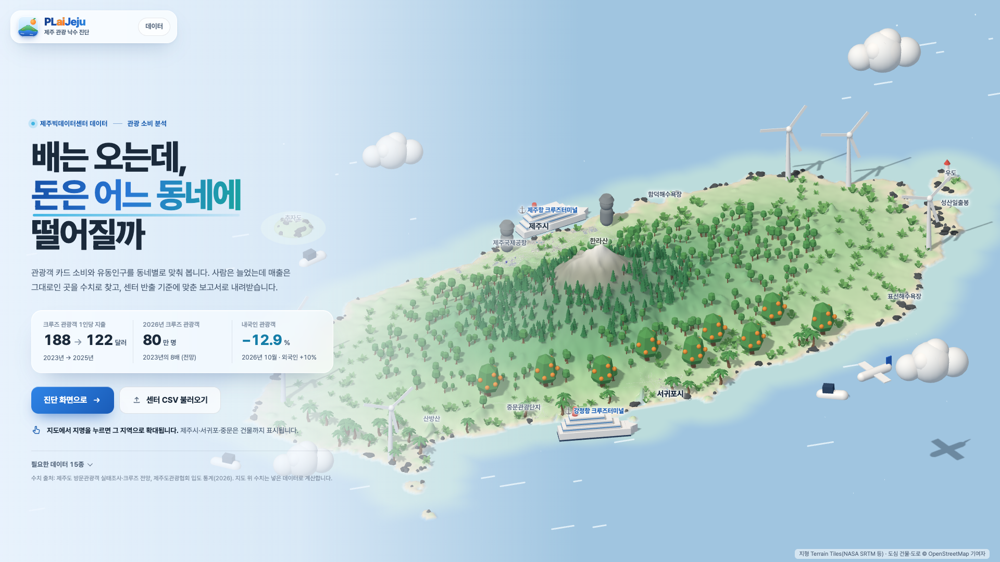
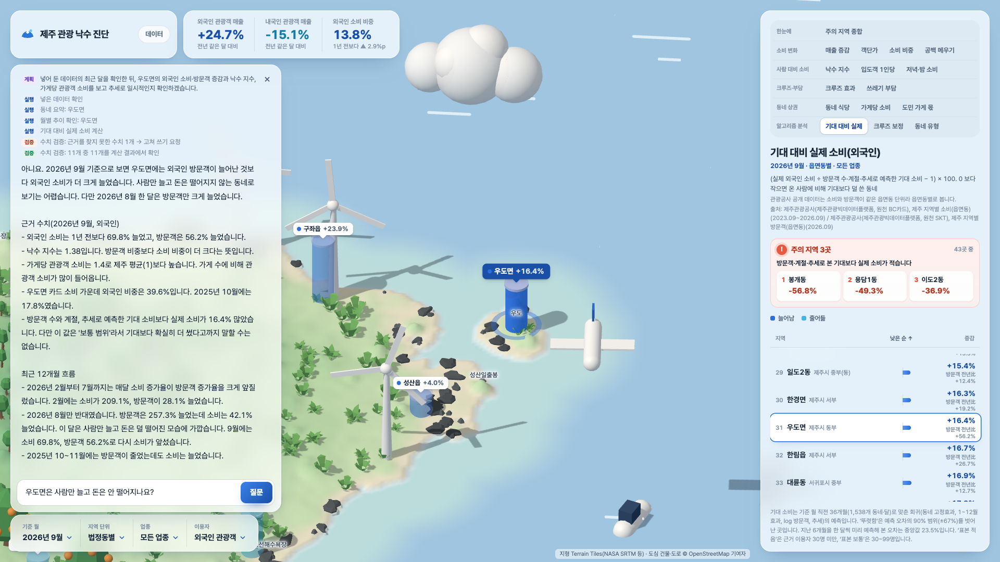
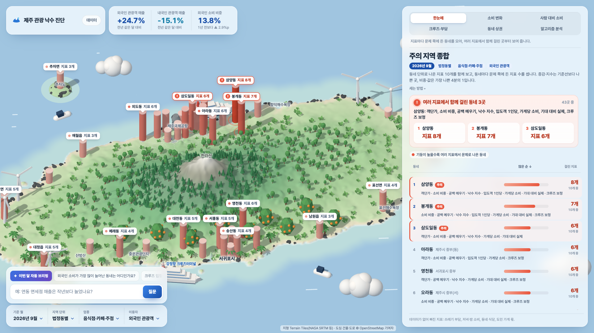
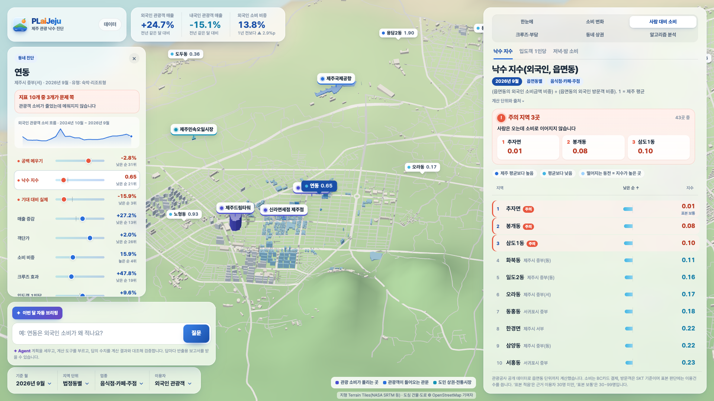
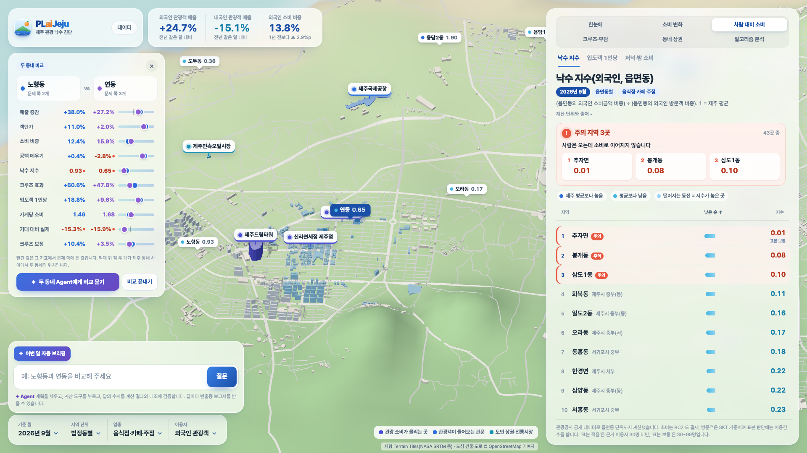
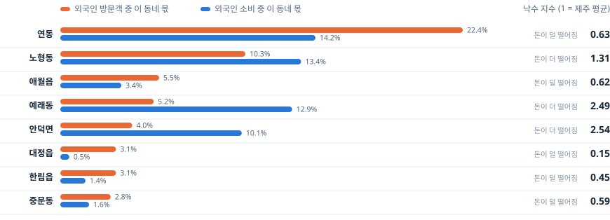
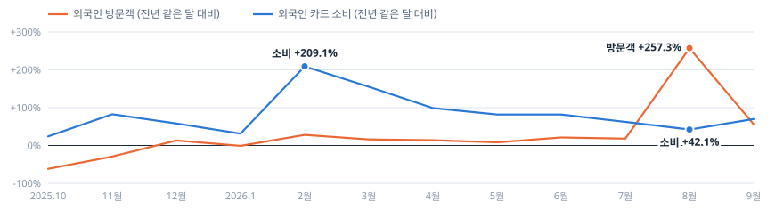
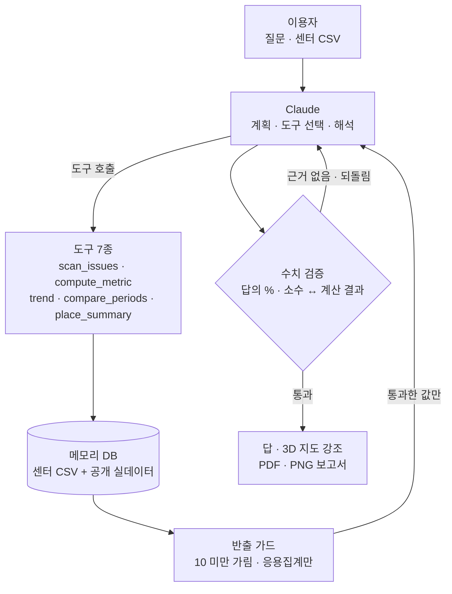

<div align="center">


# PLaiJeju

### 배는 오는데, 돈은 어느 동네에 떨어질까

**외국인·크루즈 관광객의 소비가 제주 어느 동네에 떨어지는지 말로 묻고,<br>수치를 검증한 답과 반출 기준에 맞춘 보고서를 받는 AI Agent**

<br>


### 🌐 [라이브 데모 · dataplaylabs.site](https://dataplaylabs.site) &nbsp;·&nbsp; ▶️ [시연 영상 (2분)](https://youtu.be/59jrutAWstA)

<sub>설치 없이 브라우저에서 바로 실제 Agent 에게 질문해 볼 수 있습니다 (하루 20건, 한 사람당 5건)</sub>

<br>

[기획서 PDF](docs/기획서_DataPlayLabs.pdf) · [설치·실행 안내](docs/설치_실행_안내.md) · [사용자 매뉴얼](docs/사용자_매뉴얼.md) · [데이터 활용 명세](docs/데이터_활용_명세.md) · [결과 설명자료](docs/결과_설명자료.md)

<sub>제주 AI·빅데이터 활용 AI Agent 개발 챌린지 2026 출품작 · DataPlayLabs (개인 참가)</sub>

</div>

<br>



<p align="center"><a href="https://youtu.be/59jrutAWstA"></a><br><sub>▶️ 시연 영상 보기: 실제 Claude 호출로 질문부터 보고서까지 (2분)</sub></p>

<br>

## 💡 왜 만들었나

제주 관광의 구조가 바뀌고 있습니다. 내국인 관광객은 줄고, 외국인과 크루즈 관광객은 빠르게 늘고 있습니다.

| 🚢 크루즈 관광객 1인당 지출 | 🧳 2026년 크루즈 관광객 | 📉 내국인 관광객 |
|:---:|:---:|:---:|
| **188 → 122 달러**<br><sub>2023 → 2025</sub> | **80만 명**<br><sub>2023년의 8배 (전망)</sub> | **−12.9 %**<br><sub>2026년 10월, 외국인은 +10%</sub> |

<sub>출처: 제주도 방문관광객 실태조사·크루즈 전망, 제주도관광협회 입도통계</sub>

"배는 오는데 돈은 안 온다"는 말은 많지만, **늘어난 사람만큼 돈이 어느 동네에 떨어지는지** 동네 단위로 답한 자료는 없었습니다. 카드 소비와 유동인구는 기관도, 지역 단위도 서로 달라 직접 맞춰 보기 어렵습니다.

**PLaiJeju 는 이 두 데이터를 동네 단위로 겹쳐, 사람 몫과 돈 몫이 어긋나는 곳을 찾아 줍니다.**

<br>

## ✨ 무엇을 하나

<table>
<tr>
<td width="50%" valign="top">

**💬 말로 묻기**<br>
<sub>"우도면은 사람만 늘고 돈은 안 떨어지나요?"라고 물으면 Agent 가 계획 → 실행 → 검증 순서로 답합니다.</sub>


</td>
<td width="50%" valign="top">

**🗺️ 주의 지역 종합**<br>
<sub>여러 지표에서 함께 문제로 나온 동네일수록 3D 섬 위 기둥이 높고 진하게 솟습니다.</sub>


</td>
</tr>
<tr>
<td width="50%" valign="top">

**📍 동네 진단 카드**<br>
<sub>동네를 누르면 지표별 값, 제주 안에서의 순위, 2년 소비 흐름이 한 장에 모입니다.</sub>


</td>
<td width="50%" valign="top">

**⚖️ 두 동네 비교**<br>
<sub>두 동네를 나란히 놓고, 문제 쪽 지표는 빨갛게 짚습니다. 단추 하나로 Agent 에게 이어서 묻습니다.</sub>


</td>
</tr>
</table>

- **✦ 이번 달 자동 브리핑**: 질문하지 않아도 Agent 가 스스로 문제 동네를 찾아 원인을 확인하고 브리핑을 씁니다.
- **📄 반출용 보고서**: 답마다 근거·계산식·한계·출처가 붙은 PDF 와 PNG 차트, 반출 신청 참고 문서를 zip 으로 받습니다.
- **🔌 키가 없어도 끝까지**: API 가 막히면 같은 지표·지도·보고서를 규칙 기반 **기본 모드**로 그대로 씁니다.
- **📥 CSV 끌어다 놓기**: 센터에서 받은 CSV 는 머리글만 보고 어떤 데이터인지 알아서 판별합니다. UTF-8, CP949, UTF-16 모두 읽습니다.

<br>

## 🔎 실데이터로 찾은 것

> 센터 데이터 없이, 프로그램에 든 **공개 실데이터만으로** 2026년 9월을 진단한 결과입니다. 가상 데이터가 아닙니다.

| **+24.7 %** | **43.7 %** | **−8.8 %** |
|:---|:---|:---|
| 외국인 관광객 카드 소비<br><sub>전년 같은 달 대비. 내국인은 −15.1%</sub> | 내국인 관광객 소비가 준 금액 중<br><sub>외국인 증가분이 메운 비율</sub> | 외국인 건당 결제액<br><sub>1인당 소비는 +7.4%지만 한 번에 쓰는 돈은 줄었다</sub> |

#### 사람 몫과 돈 몫이 어긋나는 동네



**연동**은 외국인 방문객의 **22.4%** 가 오지만 소비는 **14.2%** 에 그칩니다. 반대로 예래동·안덕면은 방문객 몫의 2.5배가 쓰입니다.

#### 우도: "사람만 는다"는 8월 한 달이었다



우도면은 2026년 8월에만 **방문객 +257.3%, 소비 +42.1%** 로 뒤집혔고, 나머지 달은 소비가 더 크게 늘었습니다.

<sub>소비는 비씨카드 결제만 담아 해외 간편결제와 현금이 빠집니다. 규모가 아니라 방향으로 읽어야 하며, 크루즈 효과는 인과가 아니라 함께 움직인 정도입니다.</sub>

<br>

## 🧠 Agent 구조

### 판단은 Claude 가, 계산과 통제는 코드가



| # | 단계 | 누가 | 도구 | 하는 일 |
|:-:|---|:-:|---|---|
| 1 | 의도 파악·계획 | 🟠 Claude | | 동네·달·업종·관광객 구분을 읽고 볼 지표와 순서를 정해 화면에 '계획'으로 씁니다 |
| 2 | 데이터 확인 | 🟠 Claude | `list_data` `search_datasets` | 최근 달과 가상 데이터 여부를 확인하고, 없는 데이터는 "어떤 데이터의 몇 월"을 받아 오라고 안내합니다 |
| 3 | 문제 동네 찾기 | 🟠 Claude | `scan_issues` | 지표 10종을 한꺼번에 계산해 여러 지표에 함께 걸린 동네부터 봅니다 |
| 4 | 지표 계산 | 🔵 코드 | `compute_metric` | 지표 12종과 알고리즘 3종을 계산합니다. 반출 가드를 통과한 값만 Claude 에게 갑니다 |
| 5 | 원인 좁히기 | 🟠 Claude | `trend` `compare_periods` `place_summary` | 일시적인지, 어느 업종인지, 두 달·두 동네를 비교해 확인합니다. 표본이 적으면 판단을 미룹니다 |
| 6 | 수치 검증 | 🔵 코드 | | 답의 모든 %·소수를 계산 결과와 대조하고, 근거 없는 수치는 되돌려 고쳐 쓰게 합니다 |
| 7 | 결과 정리 | 🔵 코드 | | 근거·한계가 붙은 답, 3D 섬 강조, 보고서를 만듭니다 |

<details>
<summary><b>실제 호출에서 Agent 가 내린 판단 보기</b></summary>

<br>

| 상황 | Agent 의 판단 |
|---|---|
| 크루즈 실적이 2025년 5월까지만 있음 | 최근 달 대신 2025년 5월을 기준으로 계산한다고 밝히고 진행 |
| 제주 전체로는 크루즈 효과가 커 보임 | 섬 전체의 계절·추세가 섞였을 수 있다고 보고, 크루즈 효과 보정으로 항구 주변 음식점을 다시 확인 |
| "우도면은 사람만 느나요?" | 동네 요약 → 월별 추이 → 기대 대비 실제 순서로 파고들어 "8월 한 달만 그랬다"고 답함 |
| 답에 근거 없는 수치 | 코드가 찾아 되돌렸고, Claude 가 계산 결과에 있는 값으로 고쳐 씀 |
| 질문 없는 자동 브리핑 | 도구 10번으로 봉개동·이도2동·추자면을 찾고, 표본이 적은 추자면은 판단을 미룸 |

<sub>출처: [docs/평가셋_결과.md](docs/평가셋_결과.md) (2026-11-17 실제 호출, claude-opus-5-5)</sub>

</details>

<br>

## 📊 낙수 진단 지표 12종 + 분석 알고리즘 3종

| 묶음 | 지표 |
|---|---|
| 💰 소비 변화 | 매출 증감률 · 객단가 증감률 · 소비 비중 · 내국인 공백 메우기 |
| 👥 사람 대비 소비 | **낙수 지수** (소비 비중 ÷ 방문객 비중, 1 = 제주 평균) · 입도객 1인당 소비 · 저녁·밤 소비 |
| 🚢 크루즈·부담 | 크루즈 기항 효과 · 쓰레기 부담 (방문객 1천 명당 종량제봉투) |
| 🏪 동네 상권 | 동네 식당 체감 · 도민 가게 몫 · 가게당 관광객 소비 |
| 🧮 알고리즘 | **기대 대비 실제** (회귀) · **크루즈 효과 보정** (이중차분) · **동네 유형** (k-평균) |

> 모든 지표는 증감률·비율·지수 같은 **응용집계**라 반출 기준에 맞습니다. 알고리즘은 API 없이 PC 안에서 돌아갑니다.

<br>

## ✅ 믿을 수 있게

<table>
<tr>
<td align="center" width="25%"><h3>201 / 201</h3><sub>실제 Claude 호출 10문항에서<br>계산 결과로 확인된 답의 수치</sub></td>
<td align="center" width="25%"><h3>10 / 10</h3><sub>평가셋 통과<br>평균 26초 · 합계 $1.31</sub></td>
<td align="center" width="25%"><h3>100</h3><sub>자동 테스트 통과<br>적재·가드·지표·Agent·보고서</sub></td>
<td align="center" width="25%"><h3>24 / 24</h3><sub>빈 폴더에 풀어<br>처음부터 실행하는 시험</sub></td>
</tr>
</table>

- **🛡 반출 가드**: 근거가 10 미만인 값은 가리고, 원본 행은 Claude 에게도 보고서에도 넘기지 않습니다.
- **🔢 숫자를 지어내지 않음**: 숫자는 모두 코드가 계산하고, 답에 계산 결과에 없는 수치가 있으면 되돌립니다.
- **⚠️ 인과를 함부로 말하지 않음**: 섬 전체 추세를 걷어 낸 값을 함께 보여 주고, 뚜렷하지 않으면 그렇다고 말합니다.

<br>

## 🗂 데이터

| 구분 | 데이터 | 쓰임 |
|---|---|---|
| **제주빅데이터센터** | 카드 이용 현황(1-08·1-14), 단기체류 외국인 유동인구(4-15), 내국인 유동인구(4-11), 종량제봉투(5-03), 외식업 POS(1-19), 업종별 매장 수(1-17) | 센터 PC 에서 CSV 로 받아 끌어다 놓기 |
| **공개 실데이터** | 제주관광공사 지역별 소비·방문객, 관광객 입도통계, 크루즈 입항 실적, 소상공인 상가 매장 수 | 프로그램에 넣어 두어 센터 CSV 없이도 지표 8종을 실제 값으로 계산 |

> 📦 **이 저장소에는 공개 데이터 원본(`src/golmok/reference/*.csv`)과 오프라인 설치 패키지(`wheels/`)를 넣지 않았습니다.** 각 기관의 이용조건을 지키기 위해서이며, 둘 다 대회 제출 zip 에 들어 있습니다. 받는 곳과 정리 방법은 [데이터 활용 명세](docs/데이터_활용_명세.md)에 있습니다.

<br>

## 🚀 실행하기

**설치 없이 보기**: [dataplaylabs.site](https://dataplaylabs.site) 에서 실제 데이터와 Agent 를 그대로 써 볼 수 있습니다. 공개 데모라 CSV 넣기는 막아 두었고, 질문은 하루 20건까지입니다.

**Windows (센터 PC)**: Python 3.12 를 설치한 뒤 `run.bat` 을 더블클릭합니다. 브라우저가 `http://localhost:8765` 를 엽니다. 자세한 순서는 [설치·실행 안내](docs/설치_실행_안내.md)에 있습니다.

**macOS · Linux**

```bash
python3.12 -m venv .venv
.venv/bin/pip install -r requirements.txt
cp .env.example .env        # ANTHROPIC_API_KEY 를 넣으면 Claude 로 답합니다. 비워 두면 기본 모드
.venv/bin/python -m uvicorn golmok.app:app --app-dir src --port 8765
```

> 이 저장소만 받아 실행하면 공개 데이터가 없으므로, 왼쪽 위 **데이터 → 가상 데이터 불러오기** 로 화면과 Agent 흐름을 볼 수 있습니다. 가상 데이터의 수치는 실제 통계가 아닙니다.

<details>
<summary><b>폴더 구성</b></summary>

```
src/golmok/
  agent.py      Agent 루프 (계획 · 실행 · 검증 · 고쳐 쓰기), 자동 브리핑, 기본 모드, Prompt
  tools.py      Agent 도구 7종
  metrics.py    낙수 진단 지표 12종
  models.py     분석 알고리즘 3종 (회귀 · 이중차분 · k-평균)
  guard.py      반출 가드
  loader.py     센터 CSV 판별 · 적재 (UTF-8 · CP949 · UTF-16)
  report.py     PDF · PNG 보고서
  app.py        로컬 서버 (FastAPI)
  static/       화면, 3D 장면, 지형, 소품, 장소 사진
tools/          공개 데이터 수집 · 정리, 가상 데이터, 평가셋, 기획서 · 제출 파일 제작
tests/          자동 테스트 100개
docs/           기획서, 매뉴얼, 명세, 결과 설명자료, 평가셋 결과
```

</details>

<br>

## ⚠️ 한계

- 센터 데이터는 명세서대로 만든 가상 데이터로 시험했고, 실제 센터 CSV 로는 아직 확인하지 못했습니다.
- 카드 데이터는 비씨카드 결제만 담아, 해외 간편결제와 현금이 빠진 외국인 소비는 적게 잡힐 수 있습니다.
- 월 단위 데이터라 크루즈 입항일의 효과를 직접 가르지 못합니다.
- macOS 에서 개발했습니다. Windows 11 실기 확인이 필요합니다.

<br>

## 🙏 출처와 AI 활용

- **데이터**: 제주빅데이터센터, 제주관광공사 제주관광빅데이터플랫폼, 제주특별자치도관광협회, 제주특별자치도, 소상공인시장진흥공단
- **지도와 그림**: 지형 Terrain Tiles (NASA SRTM 등) · 도심 건물·도로 © OpenStreetMap 기여자 (ODbL) · 3D 소품 Kenney (CC0) · 장소 사진 위키미디어 공용 ([사진별 출처](src/golmok/static/places/CREDITS.md)) · 글꼴 Pretendard (OFL)
- **AI 활용**: Agent 실행에 Claude API (Claude Opus 5.5) 를 씁니다. 개발에는 Claude Code 를 조사·설계·코드·문서 작성에 활용했습니다. 자세한 내용은 [데이터 활용 명세 7절](docs/데이터_활용_명세.md#7-ai-활용-내역)에 있습니다.
- **결과물 소유권**: 대회 규칙에 따라 결과물은 제주빅데이터센터에 소속됩니다.

<br>

<div align="center">
<sub>
외국인 관광객을 평가하는 도구가 아니라, 소비가 어디에 몰리고 어디가 비는지 보는 도구입니다.<br>
답변은 정책 판단을 돕는 참고 자료이며, 공식 통계와 최종 판단은 담당 기관의 몫입니다.
</sub>
<br><br>
<b>PL<span>ai</span>Jeju</b> · DataPlayLabs · 2026
</div>
